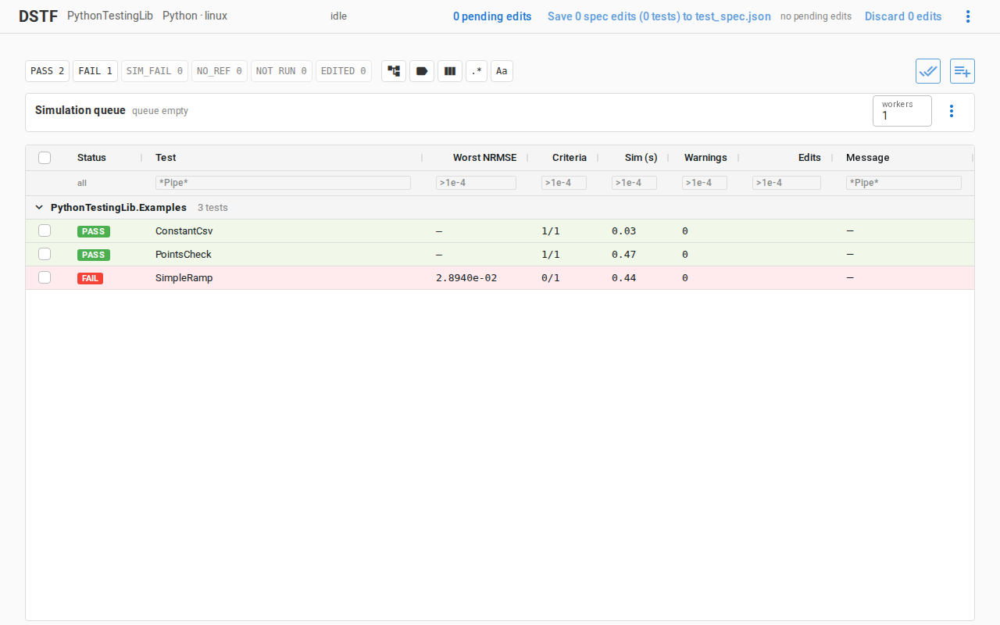
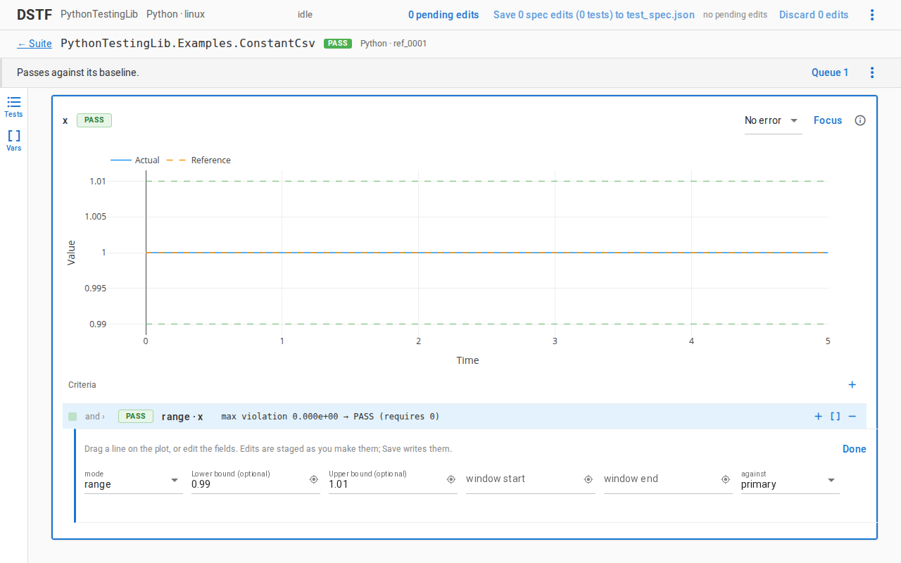

# Criteria

A criterion is one check of a run: one variable, scored by one comparison
mode, against the test's baseline or against bounds that need none. A test
passes when its criteria do. The test files call criteria `metrics`: a test's
criteria are its `metrics` tree.

The modes, each with its fields, are on the
[comparison modes reference](../reference/comparison-modes.md):
{ref}`nrmse <mode-nrmse>` (the default),
{ref}`tube <mode-tube>`, {ref}`points <mode-points>`,
{ref}`range <mode-range>`, {ref}`event-timing <mode-event-timing>`,
{ref}`dominant-frequency <mode-dominant-frequency>` and
{ref}`scalar <mode-scalar>`.

## Without a tree

A test with no `metrics` scores every variable it tracks by `nrmse` against its
baseline, and passes when all of them pass. To score one variable another way,
give it an override, a mode and that mode's fields:

<!-- snippet: test_spec -->
```json
{
  "tests": [
    {
      "model": "MyLib.Examples.PipeTest",
      "variables": ["pipe.T[1]", "pipe.p[1]", "tank.level"],
      "comparison": {
        "tolerance": 0.01,
        "variable_overrides": {
          "pipe.p[1]": {"mode": "tube", "tube_width_mode": "rel", "tube_rel": 0.02},
          "tank.level": {"mode": "range", "min_value": 0.0, "max_value": 2.0}
        }
      }
    }
  ]
}
```

`pipe.T[1]` is scored by `nrmse` with the test's tolerance, `pipe.p[1]` must
stay within 2 % of its baseline, and `tank.level` within fixed bounds, which
needs no baseline at all.

A criterion with no tolerance of its own takes the test's
(`comparison.tolerance`), else the one stored with its baseline, else the
project's (`tolerance` in `testing.json`).

## A tree

`metrics` replaces that flat list with a tree of criteria and groups. A
criterion names its `metric` and `variable`, and holds its mode's fields; a
group names its `combinator` and holds `children`:

<!-- snippet: test_spec -->
```json
{
  "tests": [
    {
      "model": "MyLib.Examples.PipeTest",
      "variables": ["pipe.T[1]", "tank.level"],
      "metrics": {
        "combinator": "and",
        "children": [
          {"metric": "nrmse", "variable": "pipe.T[1]", "tolerance": 0.01,
           "window": {"start": 10.0}},
          {"metric": "range", "variable": "tank.level", "min_value": 0.0, "max_value": 2.0},
          {"metric": "scalar", "variable": "tank.level", "quantity": {"reduce": "max"},
           "tolerance": 0.05},
          {"combinator": "warn", "children": [
            {"metric": "tube", "variable": "pipe.T[1]", "tube_width_mode": "band", "tube_abs": 0.5}
          ]}
        ]
      }
    }
  ]
}
```

This test passes when `pipe.T[1]` matches its baseline after t = 10 s, the
tank level stays within its bounds, and its maximum is within 0.05 of the
baseline's. The tube under `warn` is advisory: when it fails, the reports say
so and the test still passes.

The groups are `and`, `or`, `k-of-n` (at least `k` children pass), `warn`
(never fails its parent) and `weighted` (a weighted sum of the children's
scores, held against a threshold); the [reference](../reference/comparison-modes.md#groups)
says how each decides.

A tree scores only what its criteria name. A variable the test tracks and no
criterion scores is still recorded and plotted, and each report names it in a
warning, so a new variable that needs a criterion does not go unnoticed. Under a
tree, `comparison.variable_overrides` scores nothing.

Every name in the result is a variable, `CPUtime` and `EventCounter` included,
and any criterion may score it. A name listed in `diagnostic_variables` —
`testing.json`'s, or a test entry's own — has its summary (final, min, max)
stored in the baseline, and its curve only when a criterion needs it or the
entry's `variables` names it: a `scalar`'s final, min or max over the whole
run is scored from the summary; any other criterion stores the curve. A test that checks its event count
exactly, warns when its CPU time moves by more than 10%, and scores the
maximum of `pump.speed` within ±0.02 of the baseline's — read from the summary
its listing keeps:

<!-- snippet: test_spec -->
```json
{
  "tests": [
    {
      "model": "MyLib.Examples.PipeTest",
      "variables": ["pipe.T[1]"],
      "diagnostic_variables": ["pump.speed"],
      "metrics": {
        "combinator": "and",
        "children": [
          {"metric": "nrmse", "variable": "pipe.T[1]", "tolerance": 0.01},
          {"metric": "scalar", "variable": "EventCounter",
           "quantity": {"reduce": "final"}, "tolerance": 0, "tolerance_mode": "abs"},
          {"metric": "scalar", "variable": "pump.speed",
           "quantity": {"reduce": "max"}, "tolerance": 0.02},
          {"combinator": "warn", "children": [
            {"metric": "scalar", "variable": "CPUtime",
             "quantity": {"reduce": "final"}, "tolerance": 0.1, "tolerance_mode": "rel"}
          ]}
        ]
      }
    }
  ]
}
```

A dotted `quantity` string names a statistic of the simulator's log, such as
`"translation.nonlinear_count"`, never a variable.

## A tolerance with two sides

A tolerance is one number, or a pair that sets each side on its own. With
`d = actual − target`, a check passes when `−lower ≤ d ≤ upper`; in time,
`lower` is how much earlier and `upper` how much later. A checkpoint that may
be 0.01 under its value and 0.05 over it, and 0.5 s early or 0.1 s late:

<!-- snippet: criterion -->
```json
{
  "metric": "points",
  "variable": "tank.level",
  "points": [
    {"time": 5.0, "value": 2.0,
     "tolerance": {"lower": 0.01, "upper": 0.05},
     "time_tolerance": {"lower": 0.5, "upper": 0.1}}
  ]
}
```

A number is both sides, so `0.02` and `{"lower": 0.02, "upper": 0.02}` score
the same. `nrmse` has one ceiling, so its tolerance is always one number, and
so is the base tolerance of a test or a project.

## Editing criteria with dstf author

`dstf author` is a browser tool for writing criteria against the data they
score. It needs the `author` extra, and opens a tab on the project's last run:

```console
$ dstf --config testing.json author
```

The Suite page is the table of the tests, as the dashboard has it, with a
queue that runs the selected tests again:



A test's page draws a plot per scored variable with its criteria under it. A
number — a statistic of the log, or a listed name's final, min or max — is
not on a plot: its criterion is on the page's Statistics card, and in the
report it is in the metric tree. A criterion opens into its fields beside the plot it scores; its bounds, bands
and checkpoints can also be dragged on the plot, and Ctrl+click adds a row —
a checkpoint, a tube's control point — that settles on the data:



Edits are staged as you make them and the count of pending edits is in the
header; Save writes them to `test_spec.json`, and Discard drops them. A test
is scored by its new criteria as soon as they are staged; run it again, from
the queue or with `dstf run`, to score a new run. Accept stores the selected
tests' results as their baselines, as `run --accept` does.

To apply an edit made elsewhere — a script, another tool — write it as a
JSON-Patch and apply it with `dstf spec update`.

## Next

- [CI](ci.md).
- [Baselines](baselines.md): soft checks, which a criterion can score against.
