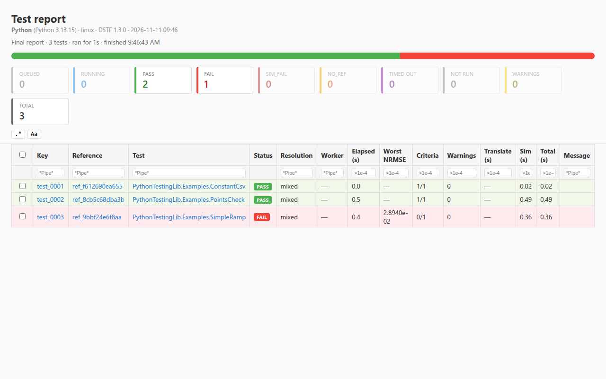
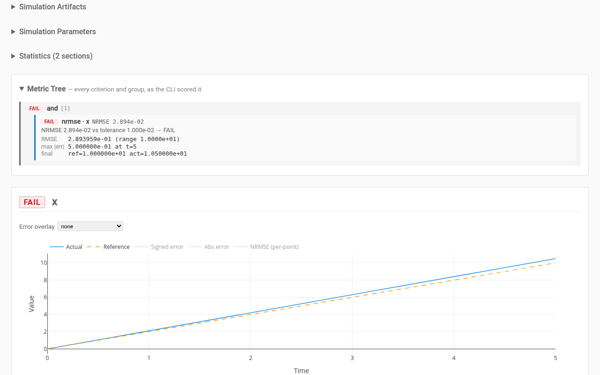

# Read the results

A run reports each test's verdict in five places: the console, the dashboard,
a page per test, two JSON files and, when asked, a JUnit file. All of them
say the same thing; pick the one that suits the reader.

## The console

A run that scores prints a line per test and the totals, then, for each
failed test, one block per criterion that did not pass:

```text
  PASS  PythonTestingLib.Examples.ConstantCsv
  PASS  PythonTestingLib.Examples.PointsCheck
  FAIL  PythonTestingLib.Examples.SimpleRamp

Results: 2/3 passed
  Failed: 1

Failure Details:
--------------------------------------------------------------------------------

  PythonTestingLib.Examples.SimpleRamp
    x: nrmse · against primary
      NRMSE 2.894e-02 vs tolerance 1.000e-02 → FAIL
      RMSE:               2.893959e-01 (range 1.0000e+01)
      max |err|:          5.000000e-01 at t=5
      final:              ref=1.000000e+01  act=1.050000e+01
```

A block's first line names the criterion: the variable, the comparison mode,
its time window if it has one, and the baseline it reads. The next line is
what was measured against what is allowed, then that mode's details. A
criterion under a `warn` group cannot fail its test: its block starts
`advisory —` and is listed after the failures, and a test whose only failures
are advisory passes, saying so on its line.

A test marked `skip` for the run's backend and OS ([Add a
test](add-a-test.md#a-test-that-does-not-run-on-one-simulator)) reads
`SKIPPED` with its reason, and the totals count it apart:

```text
  SKIPPED  PythonTestingLib.Examples.ConstantCsv (skipped on Python: its CSV reader is not ready here)
  PASS  PythonTestingLib.Examples.PointsCheck
  PASS  PythonTestingLib.Examples.SimpleRamp

Results: 2/2 passed · 1 skipped
```

A marked test run anyway (`--include-skipped`) keeps its real status and says
`(marked skip on Python)` beside it, and after the report a line says what to
do with the mark: `…: marked skip on Python, passes now — remove the mark`;
`…: marked skip on Python, runs now but has no baseline to score against —
accept one, then remove the mark` for one with no baseline (NO_REF); or
`…: marked skip on Python, still does not pass (FAIL)`. Its failure is counted
under `Failed:`, and fails no run.

## The dashboard

`dashboard.html` in the work directory is the suite on one page. During a run
it refreshes itself every few seconds; once the run is scored it holds the
verdicts:



- The count pills along the top filter the table by status; `Total` shows
  every row again.
- Every column but Status has a filter under its header. Text columns match a
  substring, or a glob when the text holds `*` or `?`; `.*` makes every text
  filter a regular expression and `Aa` makes it match case. Number columns
  take `>x`, `<=x`, `=x` or a range `a..b`.
- **Criteria** counts the criteria that passed out of all of them; **Worst
  NRMSE** is the worst score of the test's `nrmse` criteria that were scored.
  It reads `nan` when one of them scored a number that is not finite (NaN or
  inf, from a sample of the run or baseline that is not finite), and sorts above every number then. With no
  `nrmse` criterion scored, it reads `n/a (N unscored)` when N of the test's
  criteria, of any metric, were not scored, and `—` when no criterion went unscored;
  **Resolution** says whether the test's simulation settings came
  from the model's annotation, from `test_spec.json`, or both (hover for which
  field came from where).
- A row reads `SIMULATED` when its simulation ran and nothing scored it — after
  `run --accept`, for example.
- A `SKIPPED` row, in teal, has its own pill; its Message is the reason it
  was skipped, and it shows no time, page or folder link of an earlier run.
  The `Total` card counts every row, the SKIPPED ones included.

## The page of one test

`run --report` (or `compare --report`) also writes a page per test, linked
from the Test column of the dashboard. A SKIPPED test gets no page: it was
not run, and its row says why.



It shows the test's criteria tree with the verdict, the measure and the
details of each criterion, and a plot per scored variable: the run, the
baseline, and what each criterion checks — a tube's band, a range's bounds, a
checkpoint's box, a time window. A number — a statistic of the log, or a
listed name's final, min or max — has no plot: its criterion is in the
metric tree alone (in `dstf author`, on the Statistics card). Zoom and hover
to read values off a plot; the error select draws the difference from the
baseline. Soft checks and companions can be shown on a plot from its overlay
picker.

The page reads nothing from a server and changes nothing: it opens from disk,
also on a machine without a network. Its plotting library is one shared copy
in `reports/`, so move or zip the `reports/` folder whole.

## From a script

Two files in the work directory are written for programs:

- `verdicts.json` — written by every `run` and `compare` that scores. One
  entry per test: its model id, the baseline it was scored against
  (`ref_id`: `ref_<code>`, or null), its status word (`PASS`, `FAIL`,
  `SIM_FAIL`, `NO_REF`, `NOT RUN`, `SKIPPED`), a message where there is one, its warnings, its criteria
  tree with each node's verdict, score and tolerance, and its `mark`: the
  skip mark that applies here (`Python: <reason>`), or null — set also for a
  marked test that ran anyway, so a script can see why a `FAIL` left the
  exit code 0. Beside them, the totals by status — a `SKIPPED` count always,
  and `total` without the SKIPPED tests — and the exit code they give, the run's `metadata` (backend,
  tool version, OS), and `selection`: null for a run of every test the
  project has; for a run of fewer, how many tests were run (`selected`) of
  how many the project has (`of`), how many of those the flags chose a mark
  kept from running (`skipped`; under `--merge` or `--rerun` also each test
  an earlier run in the work directory recorded that a mark keeps out,
  chosen or not: it reads SKIPPED instead of being scored on its last
  result, so `--merge --filter A,B` with C marked reads as a full run), and
  what chose them — `filter`,
  `package` and `rerun` as given, `merged: true` where tests not run
  were scored on their last results (`--merge` or `--rerun` over a work
  directory that holds a result of at least one of them), and for
  `--changed-since` the revision as given (`changed_since`), the commit it
  resolved to in each repository (`commits`), how many files differ
  (`files`), how many of the tests could not be asked what they use
  (`could_not_be_asked`) and, where a changed file ran every test, why
  (`every_test`: `no class stores it`, or `its top package cannot be
  named`). `selected` and `skipped` together below `of` is not a full run:
  a run of every test its marks let run is a full one. A compare that scored
  fewer than the project's tests (its own `--filter` or `--package`)
  writes the same block with `compare: true`: `selected` is then the tests
  it scored, and it simulated none.
- `status.json` — what became of each SIMULATION: `passed` there means the
  simulation finished, not that the test passed. Once a run is scored each
  test also carries its `verdict`. Its `selection` is the run's that
  simulated, as above. `verdicts.json` and the dashboard copy it from here
  — so a later `compare` keeps it — except for two invocations that
  simulate nothing and say what they did themselves: a `compare` whose
  own `--filter` or `--package` leave fewer than the project's tests (its
  block, marked `compare: true`), and a `run --rerun` with nothing to
  rerun (`selected: 0`). `status.json` keeps the run's block then.

```python
import json

doc = json.load(open("testing_output/MyLib/Dymola/linux/verdicts.json"))
print(doc["totals"])
for test in doc["tests"]:
    if test["status"] == "FAIL" and test["mark"] is None:
        print(test["model_id"], test["message"] or "")
    elif test["status"] == "SKIPPED":
        print(test["model_id"], "skipped:", test["mark"])
```

`verdicts.json` holds the tests the last scoring command scored: after a
`--filter` run, only those.

## JUnit

`--report-format junit` writes a JUnit XML file, which a CI server shows as
test results:

```console
$ dstf --config testing.json run --report-format junit --output results.xml
```

```xml
<testsuites tests="3" failures="1" errors="0">
  <testsuite name="PythonTestingLib.Examples" tests="3" failures="1" errors="0" skipped="0">
    <testcase name="PythonTestingLib.Examples.ConstantCsv" classname="PythonTestingLib.Examples" />
    <testcase name="PythonTestingLib.Examples.PointsCheck" classname="PythonTestingLib.Examples" />
    <testcase name="PythonTestingLib.Examples.SimpleRamp" classname="PythonTestingLib.Examples">
      <failure message="1 criterion failed" type="RegressionFailure">x: nrmse · against primary — NRMSE 2.894e-02 vs tolerance 1.000e-02 → FAIL</failure>
    </testcase>
  </testsuite>
</testsuites>
```

A failed test is a `<failure>` with one line per failed criterion, a failed
simulation an `<error>`, and a test that did not run a skipped test case. A
SKIPPED test is a `<skipped message="skipped on Python: <reason>">`, and the
suite's `tests=` counts it. A marked test run anyway that does not pass is a
`<skipped>` too, not a failure — `<skipped message="marked skip on Python
(<reason>); still fails: FAIL">` — so a CI gate that reads the file agrees with
the exit code.
`--report-format html` writes the dashboard to a path of your choice instead.
The console table is printed either way, and `--report` can be added to any of
them.

## Next

- [Baselines](baselines.md): accepting results, and the reference root.
- [CI](ci.md): a job that runs the suite and keeps the JUnit file.
