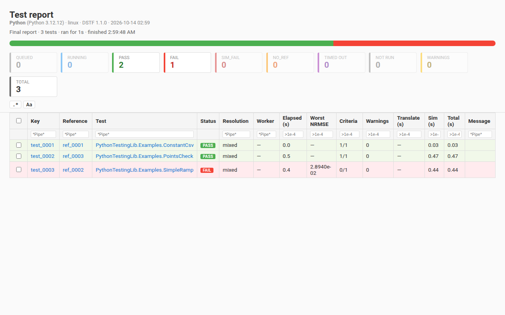
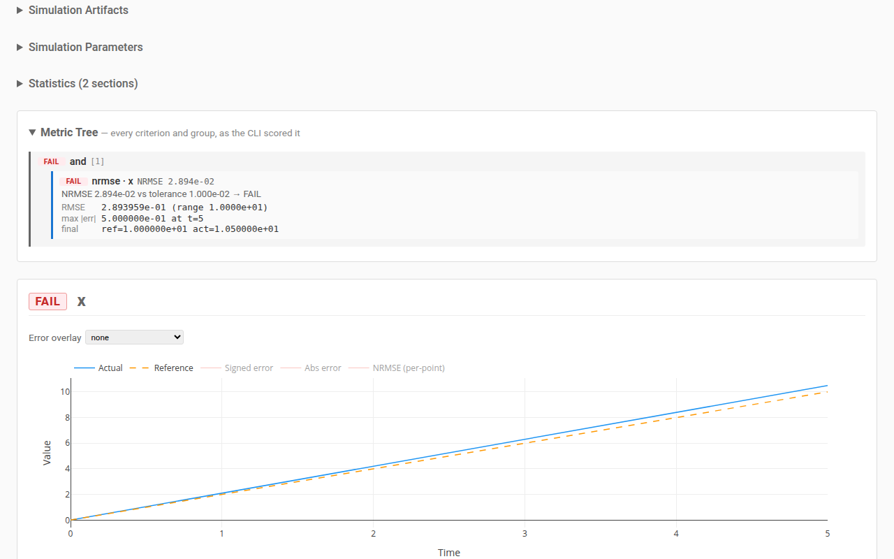

# Read the results

A run reports each test's verdict in five places: the console, the dashboard,
a page per test, two JSON files and, when asked, a JUnit file. All of them
say the same thing; pick the one that suits the reader.

## The console

A run that scores prints a line per test and the totals, then, for each
failed test, one block per criterion that did not pass:

```text
  PASS  [0001] PythonTestingLib.Examples.ConstantCsv
  PASS  [0003] PythonTestingLib.Examples.PointsCheck
  FAIL  [0002] PythonTestingLib.Examples.SimpleRamp

Results: 2/3 passed
  Failed: 1

Failure Details:
--------------------------------------------------------------------------------

  [0002] PythonTestingLib.Examples.SimpleRamp
    x: nrmse · against primary
      NRMSE 2.894e-02 vs tolerance 1.000e-02 → FAIL
      RMSE:               2.893959e-01 (range 1.0000e+01)
      max |err|:          5.000000e-01 at t=5
      final:              ref=1.000000e+01  act=1.050000e+01
```

A block's first line names the criterion: the variable, the comparison mode,
its time window if it has one, and the baseline it reads. The next line is
what was measured against what is allowed, then that mode's details. A
criterion under a `warn` group cannot fail its test: its block starts
`advisory —` and is listed after the failures, and a test whose only failures
are advisory passes, saying so on its line.

## The dashboard

`dashboard.html` in the work directory is the suite on one page. During a run
it refreshes itself every few seconds; once the run is scored it holds the
verdicts:



- The count pills along the top filter the table by status; `Total` shows
  every row again.
- Every column but Status has a filter under its header. Text columns match a
  substring, or a glob when the text holds `*` or `?`; `.*` makes every text
  filter a regular expression and `Aa` makes it match case. Number columns
  take `>x`, `<=x`, `=x` or a range `a..b`.
- **Criteria** counts the criteria that passed out of all of them; **Worst
  NRMSE** is the worst `nrmse` score of the test's criteria: `nan` when one of
  them scored no number (a NaN in the run), which sorts above every number;
  `n/a (N unscored)` when none was scored and N criteria were not; `—` for a
  test with no `nrmse` criterion; **Resolution** says whether the test's simulation settings came
  from the model's annotation, from `test_spec.json`, or both (hover for which
  field came from where).
- A row reads `SIMULATED` when its simulation ran and nothing scored it — after
  `run --accept`, for example.

## The page of one test

`run --report` (or `compare --report`) also writes a page per test, linked
from the Test column of the dashboard:



It shows the test's criteria tree with the verdict, the measure and the
details of each criterion, and a plot per scored variable: the run, the
baseline, and what each criterion checks — a tube's band, a range's bounds, a
checkpoint's box, a time window. A number — a statistic of the log, or a
listed name's final, min or max — has no plot: its criterion is in the
metric tree alone (in `dstf author`, on the Statistics card). Zoom and hover
to read values off a plot; the error select draws the difference from the
baseline. Soft checks and companions can be shown on a plot from its overlay
picker.

The page reads nothing from a server and changes nothing: it opens from disk,
also on a machine without a network. Its plotting library is one shared copy
in `reports/`, so move or zip the `reports/` folder whole.

## From a script

Two files in the work directory are written for programs:

- `verdicts.json` — written by every `run` and `compare` that scores. One
  entry per test: its status word (`PASS`, `FAIL`, `SIM_FAIL`, `NO_REF`,
  `NOT RUN`), a message where there is one, its warnings, and its criteria
  tree with each node's verdict, score and tolerance. Beside them, the totals
  by status and the exit code they give.
- `status.json` — what became of each SIMULATION: `passed` there means the
  simulation finished, not that the test passed. Once a run is scored each
  test also carries its `verdict`.

```python
import json

doc = json.load(open("testing_output/MyLib/Dymola/linux/verdicts.json"))
print(doc["totals"])
for test in doc["tests"]:
    if test["status"] == "FAIL":
        print(test["model_id"], test["message"] or "")
```

`verdicts.json` holds the tests the last scoring command scored: after a
`--filter` run, only those.

## JUnit

`--report-format junit` writes a JUnit XML file, which a CI server shows as
test results:

```console
$ dstf --config testing.json run --report-format junit --output results.xml
```

```xml
<testsuites tests="3" failures="1" errors="0">
  <testsuite name="PythonTestingLib.Examples" tests="3" failures="1" errors="0" skipped="0">
    <testcase name="PythonTestingLib.Examples.ConstantCsv" classname="PythonTestingLib.Examples" />
    <testcase name="PythonTestingLib.Examples.PointsCheck" classname="PythonTestingLib.Examples" />
    <testcase name="PythonTestingLib.Examples.SimpleRamp" classname="PythonTestingLib.Examples">
      <failure message="1 criterion failed" type="RegressionFailure">x: nrmse · against primary — NRMSE 2.894e-02 vs tolerance 1.000e-02 → FAIL</failure>
    </testcase>
  </testsuite>
</testsuites>
```

A failed test is a `<failure>` with one line per failed criterion, a failed
simulation an `<error>`, and a test that did not run a skipped test case.
`--report-format html` writes the dashboard to a path of your choice instead.
The console table is printed either way, and `--report` can be added to any of
them.

## Next

- [Baselines](baselines.md): accepting results, and the reference root.
- [CI](ci.md): a job that runs the suite and keeps the JUnit file.
