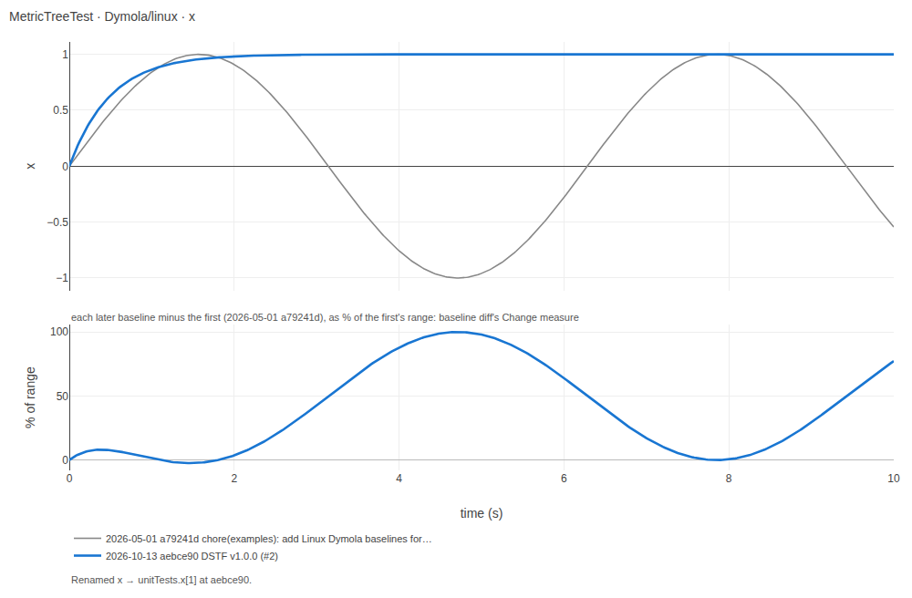

# Summarize a change for review

A pull request that accepts new baselines changes files of numbers nobody
reads line by line. `dstf baseline diff` reads them for the reviewer: which
baselines changed between two revisions of the reference root, and by how
much. `dstf summary` puts the test results of several runs side by side: the
branch against the main line, on each simulator and OS. Both print Markdown
written to be pasted into the pull request. `dstf baseline plot` draws the
changed baselines as images, in one page to send.

## What changed between two revisions

Name the older revision, then the newer one, and where the reference root is:

```console
$ dstf baseline diff main HEAD --reference-root Resources/ReferenceResults
```

Leave the newer revision out to compare with the files on disk, tracked or
not: what `dstf run --accept` leaves before you `git add` it.

```console
$ dstf baseline diff main --config testing.json -o baselines.md
```

`--config` reads only the reference root from testing.json (its
`reference_root`, or its own folder when that is named `ReferenceResults`),
never the library, so a checkout that holds only the references is enough.
git is only read: the command writes nothing to the repository.

## What it prints

By default, three things:

- **A headline:** how many tests the table lists, the two revisions, and
  how many baseline files did not change (a file per test and folder, so not
  a count of tests). When every listed test changed, it
  reads `20 tests have new baselines`; otherwise the new, removed and not
  compared tests are counted apart (`20 tests changed, 2 new, 1 removed`).
  A test is new only when no folder held a baseline of it at the older
  revision, and removed only when none holds one at the newer; a test that
  gained a baseline in one folder and kept it in another is a changed test.
  A file whose numbers are equal and whose dates or key order differ is
  unchanged, and said apart when there is one (`7 baseline files unchanged, 2
  of them only in metadata`).
- **An overview table:** one row per test, largest change first, a
  `Change, <Backend>/<os>` column per folder, then `Gap to <Backend>/<os>`
  with `--against`, then `Solver steps`: the change in accepted solver
  steps, new against old, in the first folder that records them.
- **One key line** under the table, saying what each column holds; the
  limits in full are [below](#the-limits).

What a `Change` cell can say:

| Cell | Meaning |
| --- | --- |
| `1.8 %` | the largest change of a variable there, as a percent of the old baseline's range |
| `2.9e-05 % of value` | the old series is constant: the change is a percent of its value |
| `0.004 absolute` | the old series is zero: the change is the difference itself |
| `0 %` | the file changed, but no compared sample of a tracked variable moved beyond the rounding of a file saved with fewer digits; the key line says so when no value turned non-finite and no old point fell outside the new run |
| `–` | nothing compared: no finite point on either side, or no time |
| `(+N variables)`, `(−N variables)` | N variables only the newer, or only the older, baseline holds |
| `(settings)` | the simulation settings, the sampling setting or precision, or the comparison settings changed |
| `(not finite)` | a point is NaN or infinite on one side and not the same on the other |
| `new`, `removed` | the baseline is only in the newer, or only in the older, revision |
| `=` | the test's baseline there did not change |
| `cannot be read` | the file cannot be decoded at one revision; it is not compared |
| `two baselines` | two files of the folder hold the test at one revision; neither is compared |
| blank | the folder holds no baseline of the test |

Several marks share one parenthesis: `79 % (+1 variable, settings)`.

The `Gap` column holds the largest change of any other folder against the
`--against` one, chosen as a `Change` cell's is (the largest percent, else
the largest absolute difference), with the folder it is in when there are
more than two folders, and `not finite` when any of them holds a
non-finite point: `0.47 % (OpenModelica/linux)`, or `0 % (OpenModelica/linux)`
where the tools agree on every stored sample. The `Solver steps` column
reads `±0 %` where the count of steps did not change, `=` where that
folder's baseline did not change, and `–` where it records no steps.

A baseline written before DSTF recorded its sampling holds none: when the
newer one does, nothing is compared there, and the detail says `sampling
first recorded (<setting>, <precision>)`. The point counts a run produced
are listed beside the settings, never as one.

`--details` adds, after the key line, the two revisions' commit subjects
and a folded section for every test, and `--details NAME ...` only for the
named ones, each a short name or a full model id:

```console
$ dstf baseline diff main HEAD --config testing.json --details NSSS_Test
```

A section holds each variable's change and when it happens (its columns
`Change, <Backend>/<os>`, and with `--against` `Gap, <Backend>/<os> to
<Backend>/<os>`), the settings that changed, and the solver statistics
old → new. The times (CPU time, wall
time) are on a line of their own: they measure the machine as much as the
solver. A GitHub pull-request body holds 65,536 characters; past that the
Markdown is still printed whole, and a note on stderr says its length.

A short example, two tests of a library in two folders:

```text
**2 tests have new baselines** (`ca9352b` → `06bc0b1`). 1 baseline file unchanged.

| Test | Change, Dymola/linux | Change, OpenModelica/linux | Gap to Dymola/linux | Solver steps |
| --- | --- | --- | --- | --- |
| `HeatedRod` | 1.5 % | 0.20 % (settings) | 1.3 % | −9.1 % |
| `Valve` | = | new | 0.17 % | = |

Change = the biggest move of a tracked variable, old → new, as % of its range. Gap = the same, between tools or OSes, after the change. Solver steps: Dymola/linux, new vs old. Only stored points are compared. = unchanged; blank = no baseline.
```

## How a change is measured

Baselines are paired by model id inside each folder, never by file name, so
a renamed file holding the same data is no change. A baseline's variables
are paired by name; the ones left over on both sides are then paired by
label (the expression, else the name, read without white space: `a[1,1]` is
`a[1, 1]`) where one variable of each side holds it, so a variable renamed
with what it reads kept (`PHS.p` becoming `unitTests.x[1]` with `PHS.p` as
its expression) is compared across the rename, and the detail says
`renamed PHS.p → unitTests.x[1]`. For each variable the change is the largest difference between the two baselines, |new − old|,
with the new one read on the old one's time grid, as a percent of the old
baseline's range (of its value where the old baseline is constant: the scale
the `nrmse` score divides by; the absolute difference where it is zero), and
the time it happens. At an event, a time stored twice or more, the value
just before is compared with the value just before, and the one after with the
one after; a sample between them, at a time stored three times or more, is
compared with the new one's sample of the same place there when the new
baseline stores that time as many times, and is otherwise counted, not
compared.

A difference that is only the rounding of a file saved with fewer digits is
no change. A baseline written before DSTF recorded its sampling spells its
numbers at some number of significant digits (7, or more where its numbers
show more); one that records it spells its run's own numbers exactly. Where
the two files hold the same stored points and, point by point, each time and
each value agrees within one step of the last digit either file spells, the
cell reads `0 %`: a baseline accepted again at single precision with its
numbers kept (`231.3005` read back as `231.300491`) is such a file. Two
files that both record their sampling never differ by rounding. The detail
keeps the true size and names it: `0 % (rounding: 3.7e-06 % of value)`.

`--against Dymola/linux` adds the `Gap` column: every other folder's newer
baseline scored against that folder's newer one, by the same rule.

## The limits

- Only the stored samples are compared: what a run did between two of them
  is not seen.
- The old baseline's points outside the new one's time span are counted, not
  compared, and so are the middle samples of an event the new one stores
  another number of times.
- A baseline that cannot be read at one revision, or a model held by two
  files of one folder, is named and not compared.
- It prints facts. Whether a change is acceptable is the reviewer's call.

`--format json` writes every fact, every test's detail included, with a
number that is not finite written as `null` beside a flag that says which.

## Plots across commits

`dstf baseline plot` draws what the numbers say: a test's stored baseline at
two revisions or more, one PNG image per variable that moved, and one
`gallery.html` that holds every image, to send to a reviewer who is not at
the machine.

```console
$ dstf baseline plot main HEAD --config testing.json -o plots
$ dstf baseline plot v1.2.0 v1.3.0 HEAD --test NSSS_Test --folder Dymola/linux -o nsss
```



On top, the baseline at each revision: the first in grey, the later ones in
blues, the newest heaviest. Under it, each later revision minus the FIRST,
read on the first's time grid, as a percent of the first's range: the
measure `baseline diff` prints as `Change`, so with two revisions the
panel's peak is that number (of the value for a constant, `% of value`; the
difference itself where the first is all zero). A point where the difference
is not finite is a gap in the line and an `×` on the panel's zero line.

Which images:

- **The tests:** by default, those `baseline diff` from the first to the
  last revision lists as changed or new; `--test` names them instead, each a
  short name or a full model id. A test it names that did not change between
  the first and the last revision is drawn too, last in the gallery and
  without a row.
- **The folders:** each `<Backend>/<os>` where two revisions hold different
  values; `--folder` chooses. `--test` and `--folder` come after the
  revisions.
- **The revisions:** one where the folder holds no baseline of the test, or
  one that cannot be read, is skipped, and one whose values equal the last
  revision drawn is skipped too (`Skipped: 999ddfb (equal to 6ad1765)`).
  Variables are paired as `baseline diff` pairs them, so a revision that
  only renamed them is skipped, and a renamed variable is one image, its
  rename said at the revision that made it. Over 12 revisions in a folder,
  the first, the last and the 10 that moved most are drawn. Each image's
  notes say what was skipped or left out, each rename, where a variable
  added later was first stored, and the points not compared or not finite.
- **The variables:** each one that moved: at some later revision its change
  against the first revision that holds it is not nothing (a point that
  moved beyond the rounding of a file saved with fewer digits, as `baseline
  diff` reads it against the first revision's file; a difference not
  finite; or a point not compared). A variable added or removed between the revisions moved only
  where it then changed. The others are named in one line under the folder
  (`Not drawn, unchanged: a, b, c. Not drawn, rounding of the saved digits
  only: d.`, each list cut past ten names), and a folder where nothing moved
  draws nothing.
- **The constants:** a variable that holds one value at every stored point,
  at each revision, is never drawn, whether it moved or not. Each folder's
  constants are one table under its images: a row each, its value at each
  revision at the digits that revision's file holds (`–` where it is not
  stored), and its `Change` from the first revision to the last in `baseline
  diff`'s words (`0 %`, `100 % of value`). A NaN at every point is one value.

The gallery lists the revisions with their subjects, then each test,
largest change first, with its row of `baseline diff`'s overview, its
images and its table of constants. Every image is inside the file and nothing is fetched: it opens
offline, and it is the one file to attach.

The images are drawn by the plotly.js DSTF ships, in a headless Chromium
that Playwright starts. Install the `browser` extra and its Chromium once:

```console
$ pip install 'dynamic-systems-testing-framework[browser]'
$ python -m playwright install chromium
```

`-o DIR` is created when it is not there. A directory that holds anything
this command did not write is refused, so it never mixes into a folder of
yours (`-o .` included); one it wrote before is written again, its old
images removed. Without `--test`, more than 300 images (of the variables
that moved) are refused: a
commit that re-accepts a whole library is drawn a test at a time. Each
refusal is one sentence, exit code 2, before anything is written. git is
only read.

## The results of several runs

A scoring `dstf run` or `dstf compare` writes `verdicts.json` in its work
dir. `dstf summary` reads one or more of them, each named `LABEL=DIR`, and
prints a matrix: a row per `<Backend>/<os>`, a column per label, in the
order given.

```console
$ dstf summary main=../main/testing_output branch=testing_output --base main
```

Each DIR is searched for `verdicts.json` files (those under `reports/` are
not runs), and each file is one cell, its backend and OS the ones the file
names. A label may repeat: a change run on Windows and on Linux has its work
dirs in two places, and `branch=out/linux branch=winout` makes one column.

- **A cell** is the tests that passed over the tests run (`2/3`), then in
  one parenthesis the other status words' counts (`1 SIM_FAIL`) and, with
  `--base` and a test not passing there, `N also fail on main`: how many of
  the tests not passing there also fail on the base. A test counts when the base,
  in the same backend/os, failed it too (FAIL or SIM_FAIL) or ended it with
  the same status; a base that had no baseline for it (NO_REF) or never ran
  it (NOT RUN) did not fail it. A label with no run of a backend/os reads
  `–`. NOT RUN is counted in the total and is not a pass. One key line under
  the matrix says this short.
- **A folded list per cell** names each test that did not pass, its status,
  and what failed: the first failing criterion that is not advisory, else
  the message from its first OpenModelica error tag (`[translation:error:63]
  Internal error …`, not the call omc echoes before it), else the message's
  last line that is not a repeated warning (a failed simulation's message is
  often a traceback, and its reason comes last).
  With `--base` the base's status is beside it, or `not in main`. Its summary
  line reads `Python/linux, branch: 2 not passing, 1 also fails on main`. A
  list holding a test that is new is open; the others, and the base's own
  lists, are folded. Where the base has no run of that backend/os, the line
  says so, nothing is counted and the list is open.

A short example:

```text
| Tool / OS | main | branch |
| --- | --- | --- |
| Python/linux | 2/3 (1 SIM_FAIL) | 1/3 (1 FAIL, 1 SIM_FAIL; 1 also fails on main) |

Passed / run. "also fails on main" = the test fails on main too (or ends there the same way).
```

The command is refused, with one sentence and exit code 2, when an argument
is not `LABEL=DIR`, a DIR holds no `verdicts.json`, a file names no backend
and OS, one label holds two files of one backend/os (two libraries in one
work dir: pass each work dir as its own `LABEL=DIR`), one file is read twice
under a label (a DIR given twice, or one inside another), or `--base` names
no label. It prints facts: whether a failure blocks the change is the
reviewer's call. `--format json` writes the same facts as data.

## Next

- [CI](ci.md): run the tests on every pull request.
- [Baselines](baselines.md): accepting results, and the reference root.
